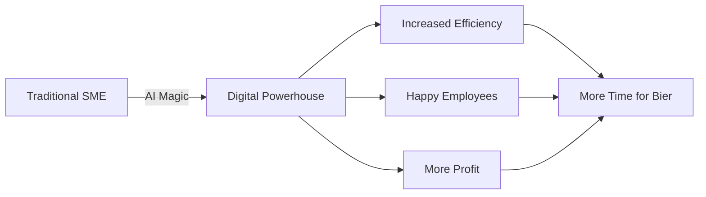

# 🚀 Marco Mengele - Where Pipes Meet Pipelines

<div align="center">
  
  
  
  
  
  [](https://linkedin.com/in/marco-mengele)
  [](https://well-ux.com)
  [](mailto:info@well-ux.com)
  
</div>

---

<div align="center">
  
  
  ### "I used to fix water leaks, now I fix memory leaks" 💧➡️💾
</div>

---

## 🎭 Who Am I? (Identity Crisis Loading...)

```javascript
const marcoMengele = {
  currentRole: "CEO @ Wellux - Making AI Work for SMEs",
  previousLife: "Master Plumber & Energy Consultant",
  superPowers: [
    "🔧 Can debug both pipes and pipelines",
    "🤖 Teaching AI to speak Bavarian",
    "💡 Converting traditional businesses to digital natives",
    "🏗️ Building the bridge between craft and code"
  ],
  dailyRoutine: {
    morning: "Check for water leaks",
    noon: "Check for memory leaks",
    evening: "Check for business leaks (inefficiencies)",
    night: "Dream in binary and water pressure calculations"
  },
  motto: "If you can't fix it with code, try duct tape. If that doesn't work, call me."
};
```

## 🏆 Achievement Unlocked: Career 180°

<table>
  <tr>
    <td width="50%">
      
### 🔧 The Analog Days
- **Meister für Sanitär, Heizung & Klimatechnik**
  - Fixed pipes before fixing bugs
  - Certified Energy Consultant (Buildings)
  - Leak Detection Expert @ Belfor Deutschland
  - "Have wrench, will travel"
      
    </td>
    <td width="50%">
      
### 💻 The Digital Revolution
- **Founder & CEO @ Wellux**
  - AI & Digitalization for Bavarian SMEs
  - Turning "Des basst scho" into "Das läuft automatisiert"
  - Making KMUs sexy again (digitally speaking)
  - Professional PowerPoint-to-Production Pipeline Expert™
      
    </td>
  </tr>
</table>

---

## 🛠️ My Tech Stack (From Pipe Wrench to Tech Stack)

<div align="center">

### Languages & Frameworks


### AI & Automation


### Databases & Cloud


### Also Proficient In


</div>

---

## 📊 GitHub Stats (Because Numbers Don't Lie, Unlike My Plumbing Estimates)

<div align="center">
  
  
</div>

<div align="center">
  
</div>

---

## 🎯 Current Mission: Digitalize Bavaria, One KMU at a Time

<div align="center">
  
</div>

### 🚀 What I'm Building at Wellux



**Translation for Non-Germans:**
- KMU = SME (Small/Medium Enterprise)
- KI = AI (but cooler because it's German)
- Bier = Essential fuel for Bavarian innovation

---

## 💡 Fun Facts About Me

<details>
<summary><b>🎪 Click to reveal my secrets!</b></summary>

- 🔧 I can diagnose a leaky pipe faster than a memory leak
- 🎯 My code is like German engineering: Over-engineered but reliable
- 🍺 I debug better after a Maß (don't try this at production)
- 🤖 Teaching AI to understand Bavarian dialect (Servus, ChatGPT!)
- 💧 Water pressure calculations > Big O notation (fight me)
- 🏗️ Built more pipelines than CI/CD could ever dream of
- 🎮 Favorite game: Pipe Dream (obviously)
- 📚 Currently reading: "From Pipes to Python: A Plumber's Journey"

</details>

---

## 🎬 My Developer Journey

```
2015: "What's this Bitcoin thing?" 🤔
2020: "AI is the future!" 💡
2023: "Let me automate that for you" 🤖
2024: "Founded Wellux - KI für KMUs" 🚀
2025: "Teaching SMEs to speak AI fluently" 🎯
```

---

## 🏗️ Featured Projects

<div align="center">
  
| Project | Description | Tech | Status |
|---------|-------------|------|--------|
| 🌐 [Wellux Website](https://well-ux.com) | AI Consultancy Platform | React, TypeScript, Supabase |  |
| 🤖 KI-Assessment Tool | Digital Readiness Checker | Next.js, AI APIs |  |
| 📊 ROI Calculator | AI Investment Calculator | React, Recharts |  |
| 🔧 Leak-to-Tech | My Career Transition Blog | Markdown, Tears |  |

</div>

---

## 📈 2025 Goals

- [ ] Digitalize 100+ Bavarian SMEs
- [ ] Launch AI-powered leak detection system (coming full circle!)
- [ ] Teach my plumber friends to code
- [ ] Create "Duct Tape Programming" methodology
- [ ] Get my Handwerker buddies to use GitHub
- [ ] Build an AI that understands "Des basst scho"
- [ ] Achieve legendary status in both plumbing AND programming

---

## 🤝 Let's Connect!

<div align="center">

### 💬 "Got leaks in your business process? Let's fix them with AI!"

Whether you need to fix a pipe, debug some code, or transform your traditional business into a digital powerhouse, I'm your guy!

📧 **Email:** info@well-ux.com  
🌐 **Website:** [well-ux.com](https://well-ux.com)  
💼 **LinkedIn:** [Marco Mengele](https://linkedin.com/in/marco-mengele)  
📍 **Location:** Bavaria, Germany (Where the pretzels are soft and the code is hard)

</div>

---

## 🎪 Random Dev Joke of the Day

<div align="center">
  
</div>

---

## 🎵 Currently Vibing To

<div align="center">
  
  [](https://github.com/kittinan/spotify-github-profile)
  
  *"From fixing water flow to improving cash flow" 🎵*
  
</div>

---

<div align="center">
  
  ### 🚰 "In code we trust, but always keep a plunger handy!"
  
  
  
  ---
  
  <sub>Built with ❤️, 🍺, and a healthy dose of Bavarian engineering</sub>
  
  <sub>⭐ Star this repo if you appreciate the journey from pipes to Python!</sub>
  
</div>

<!-- 
  Dear fellow developer who's reading this source,
  
  Yes, I went from fixing physical leaks to fixing memory leaks.
  Yes, I still carry a wrench in my laptop bag.
  No, I don't regret anything.
  
  If you've made it this far, you deserve a beer! 🍺
  Hit me up and let's discuss how duct tape programming 
  could revolutionize the industry.
  
  Remember: If it's not broken, you're not trying hard enough!
  
  - Marco "The Plumber Programmer" Mengele
-->

<!-- Easter Egg: Konami Code activates plumbing mode on my website -->
